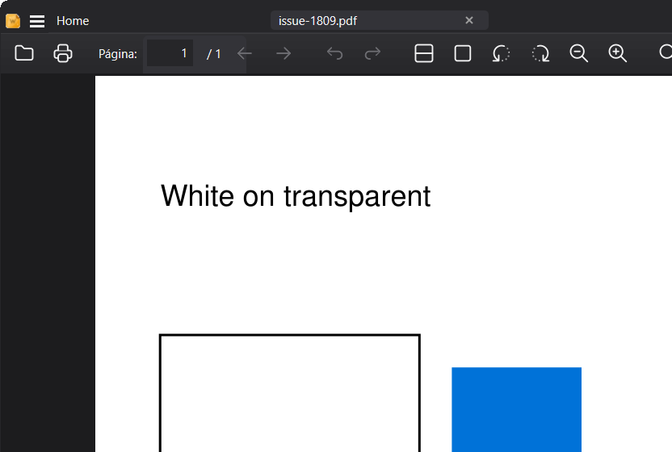
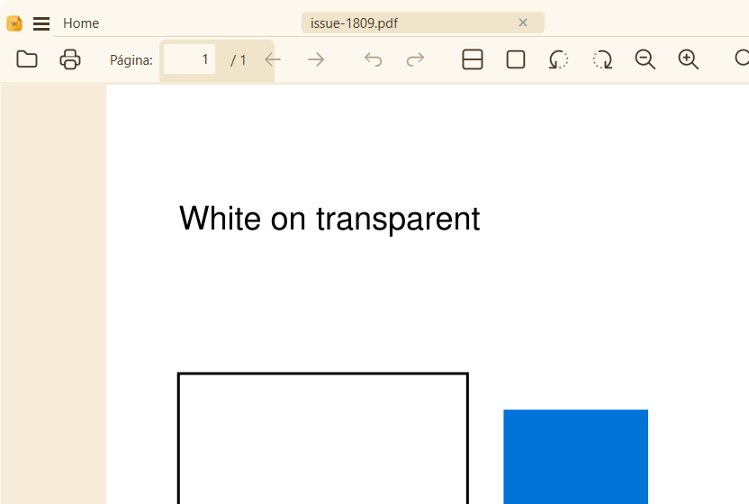

# WiniPDF

**Español** · [English summary](#english) · [Descargar](https://github.com/osvrangel03-ranger/WiniPDF/releases/latest)

Un lector de documentos **rápido y ligero** para Windows, con identidad visual
propia y la interfaz en español.

WiniPDF es un fork de **[SumatraPDF](https://github.com/sumatrapdfreader/sumatrapdf)**,
el mejor lector ligero de Windows, creado por **Krzysztof Kowalczyk** y su
comunidad. El motor, la velocidad y décadas de refinamiento son suyos: este
proyecto existe gracias a ellos.

  &nbsp;
  

Temas propios <b>WiniCarbon</b> y <b>WiniAmber</b>, siguiendo el modo claro/oscuro de Windows

---

## ¿Qué es y qué no es?

**Es** un lector de documentos que se siente actual en Windows 11 sin dejar de
abrir al instante: temas propios, español completo, icono con identidad, barra y
pestañas con material, página de inicio modernizada.

**No es** un lector "con más funciones". No hay IA, ni edición, ni conversión, ni
una tienda de extensiones. El motor es el de SumatraPDF y se deja en paz.

La regla con la que se decide cada cambio: **si resta velocidad o suma peso, no
entra**. La identidad se construye con acabado, no con funciones.

## ¿Por qué "la piedra de ámbar"?

> *El ámbar encapsula y deja ver sin alterar. Eso es un PDF.*

El ámbar preserva lo que atrapa durante millones de años: visible, intacto,
intocable. Exactamente la promesa del formato PDF. El icono es una piedra de
ámbar estilizada con un pliegue de página; dentro, una hoja con la **W** de
WiniPDF — preservada, como todo lo que abras con este lector.

El dúo negro + ámbar es además un homenaje a los colores de SumatraPDF.

## Cómo está hecho (y por qué no lo reescribimos)

WiniPDF **no** es una aplicación nueva: es SumatraPDF parcheado en su sitio. Eso
es una decisión, no una limitación.

La idea de "sacarle el esqueleto" al programa y meterlo en un cuerpo moderno
(Qt, WinUI, GPUI, WebView2) suena bien y es una trampa: el esqueleto *es* la
aplicación. Años de manejo de ventanas Win32, renderizado, scroll, foco,
accesibilidad y casos raros están entrelazados con la interfaz. Moverlo a otro
cuerpo significa reescribir la mitad del programa, congelar el producto durante
meses y —casi seguro— perder la velocidad de apertura que es justo lo que hace
especial a Sumatra.

Así que la apuesta es la contraria: **conservar el motor y el esqueleto, y
modernizar la piel con parches pequeños y reversibles**. El valor del fork se mide
en el tamaño del diff (~2.500 líneas en ~18 archivos). Cada parche está marcado
con `// WiniPDF:` y documentado, para poder reaplicarlo cuando el proyecto se
sincronice con el upstream.

## Qué cambia respecto a SumatraPDF

- **Dos temas propios**: `WiniCarbon` (oscuro) y `WiniAmber` (claro), con
  jerarquía de superficies, píldoras redondeadas y pestañas tipo cápsula.
- **Español completo**: las ~1.400 cadenas que usa la aplicación, no una
  traducción a medias.
- **Identidad**: icono, nombre, *Acerca de* propio (`vX.Y.Z (base 3.7)`),
  diálogos con marca y chequeo de actualizaciones apuntando a nuestras releases.
- **Inicio moderno**: buscador redondeado con lupa, tipografía del sistema,
  selector de vista en chips y botón "Abrir…" con superficie.
- **Material en el chrome**: la barra y la banda de pestañas insinúan el fondo
  del escritorio (difuminado y teñido con el tema), y el marco de la ventana va
  redondeado.
- **Detalles de uso**: botón "+" para abrir otro documento en una pestaña nueva,
  página como chip, y las pestañas con cierre al pasar el ratón.

## Formatos

Todo lo que abre SumatraPDF: **PDF, EPUB, MOBI, XPS, DjVu, CHM, CBZ/CBR, FB2,
TXT/Markdown** e imágenes (PNG, JPEG, WebP, AVIF, entre otras).

## Descargar y usar

- **Portable**: baja `WiniPDF.exe` (o el `.zip` con las DLLs) de
  [Releases](https://github.com/osvrangel03-ranger/WiniPDF/releases/latest) y
  ejecútalo. No requiere instalación.
- **Instalador**: `WiniPDF-0.7.0-instalador.exe`. Pregunta lo justo: para quién
  (tú o todos los usuarios), carpeta, tema inicial (Carbón, Ámbar o seguir a
  Windows), accesos directos y si quiere registrar los formatos con su icono.
  Al terminar ofrece abrir la página de Aplicaciones predeterminadas para
  dejarlo como lector por defecto.

WiniPDF **no está firmado digitalmente**, así que Windows puede mostrar el aviso
de SmartScreen la primera vez ("Más información → Ejecutar de todas formas"). No
es un error: es el precio de no pagar un certificado de firma. Se puede verificar
el binario con el SHA-256 publicado en cada release.

Requisitos: Windows 10 u 11 (64 bits).

## Estado del proyecto

Beta temprana y usable a diario. Lo que falta, en orden:

1. Sincronizar con el upstream (el fork va ~2.700 commits por detrás; faltan
   correcciones del motor).
2. Pulido: animaciones de hover, barra de búsqueda flotante, barra de desplazamiento
   fina y diálogos que crezcan con textos largos.
3. Vista rápida con la barra espaciadora y modo rápido sin animaciones.

Los fallos y las ideas se reportan en
[Issues](https://github.com/osvrangel03-ranger/WiniPDF/issues). Si prefieres
escribir por correo —para sugerir funciones, mandar capturas o lo que sea—:
**osv.rangel03@gmail.com**.

## Créditos

- **Motor y base**: [SumatraPDF](https://github.com/sumatrapdfreader/sumatrapdf),
  de **Krzysztof Kowalczyk** y su comunidad, más las librerías de terceros
  (MuPDF y compañía, ver `AUTHORS`).
- **Identidad, icono y dirección de diseño**: **Osvaldo**
  ([@osvrangel03-ranger](https://github.com/osvrangel03-ranger)).
- Desarrollo asistido por herramientas de IA de código abierto.

## Apoya el proyecto

WiniPDF es gratis y seguirá siéndolo. Las donaciones van íntegras a las
herramientas de desarrollo (compilación, IA y automatización).

**GitHub Sponsors** es el único medio de donación:
[github.com/sponsors/osvrangel03-ranger](https://github.com/sponsors/osvrangel03-ranger).
No hay PayPal ni ninguna otra vía; si otro sitio pide dinero "para WiniPDF", no
somos nosotros.

## Licencia

**GPLv3**, heredada de SumatraPDF. El código de este fork también es libre: si
modificas y distribuyes WiniPDF, tienes que publicar tus cambios con la misma
licencia.

---

## English summary

WiniPDF is a **fast, lightweight document reader for Windows** with its own visual
identity and a Spanish-first interface. It is a fork of **SumatraPDF** by
Krzysztof Kowalczyk and its community; the engine and its speed are entirely
theirs.

It is **not** a feature-heavy reader: no AI, no editing, no conversion. The fork
exists to give the app a modern, coherent finish (two themes, complete Spanish,
icon, rounded chrome with simulated backdrop blur, a modern home page) while
keeping SumatraPDF's legendary startup speed.

**Why not rewrite the GUI?** Because the Win32 skeleton *is* the app: replacing
it with Qt, WinUI, GPUI or WebView2 would mean rewriting half the program, months
with the product frozen, and losing the speed that makes Sumatra special. The
choice is to keep the engine and modernize the skin with small, reversible
patches (~2,500 lines in ~18 files), each marked `// WiniPDF:`.

**Formats**: PDF, EPUB, MOBI, XPS, DjVu, CHM, CBZ/CBR, FB2, TXT/Markdown and
images. **Portable** `.exe` (installer planned). Not code-signed: SmartScreen may
warn on first run.

**Contact**: [issues](https://github.com/osvrangel03-ranger/WiniPDF/issues) or
osv.rangel03@gmail.com.

**License**: GPLv3. **Donations**: GitHub Sponsors only.
